# TÀI LIỆU ĐẶC TẢ YÊU CẦU CHỨC NĂNG VÀ KIẾN TRÚC HẠ TẦNG HỆ THỐNG
## HỆ THỐNG TỰ ĐỘNG HÓA KIỂM THỬ THÔNG MINH (AUTOTC - AI AUTOMATION DASHBOARD)

* **Phiên bản:** 2.0
* **Thời gian cập nhật:** Tháng 11/2026
* **Đơn vị phát triển:** Đội ngũ AutoTC Team
* **Đối tượng tiếp nhận:** Tester, QA Lead, Business Analyst (BA), Software Engineer, Project Manager (PM)

---

> 📌 **MỤC TIÊU & PHẠM VI TÀI LIỆU:**
> Tài liệu này được biên soạn toàn diện nhằm đặc tả chi tiết kiến trúc hạ tầng kỹ thuật phân tán và 10 nhóm tính năng nghiệp vụ cốt lõi của hệ thống **AutoTC**. Toàn bộ các quy trình nghiệp vụ đều được minh họa bằng hình ảnh chụp màn hình thực tế từ hệ thống đang vận hành, giúp người dùng nắm vững cách thao tác và hiểu rõ các cơ chế điều phối AI bên dưới.

---

## PHẦN I: KIẾN TRÚC HẠ TẦNG HỆ THỐNG (SYSTEM INFRASTRUCTURE ARCHITECTURE)

Hệ thống **AutoTC** là giải pháp tự động hóa kiểm thử phần mềm toàn diện (End-to-End Test Automation), kết hợp giữa giao diện quản lý Single Page Application (SPA), máy chủ Backend Python đa luồng xử lý bất đồng bộ, cơ sở dữ liệu thời gian thực Supabase Cloud, hệ sinh thái Google Workspace và nền tảng suy luận ngôn ngữ lớn Viettel AI MaaS.

### 1. Sơ đồ Kiến trúc Phân lớp Kỹ thuật

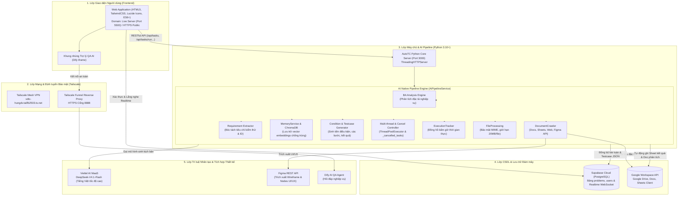

---

### 2. Chi tiết 5 Phân lớp Hạ tầng Kỹ thuật

#### A. Lớp Giao diện Người dùng (Frontend)
* **Công nghệ cốt lõi:** HTML5, CSS3, Tailwind CSS (triển khai CDN tối ưu), bộ icon Lucide Icons, Vanilla JavaScript hiện đại (ES6+), Supabase JS Client v2.
* **Môi trường hoạt động:** Hỗ trợ cả môi trường phát triển cục bộ qua Live Server (`http://127.0.0.1:5500`) lẫn môi trường Production máy chủ phân tán.
* **Các trang giao diện:**
  * `index.html`: Bảng điều khiển trung tâm quản lý bài toán, thêm/sửa/xóa, kích hoạt pipeline AI, theo dõi tiến độ thời gian thực.
  * `review.html`: Màn hình chuyên dụng toàn trang phục vụ duyệt, chỉnh sửa chi tiết và phản hồi testcase cho AI.
  * `login.html`: Cổng đăng nhập xác thực tập trung.
* **Cơ chế truyền thông:** Fetch API bất đồng bộ kết hợp `AbortController` cho phép ngắt các request khẩn cấp an toàn mà không làm đơ trình duyệt.

#### B. Lớp Máy chủ Dịch vụ & Pipeline AI Backend (Python 3.10+)
* **Máy chủ dịch vụ:** Sử dụng `ThreadingHTTPServer` đa luồng, hỗ trợ xử lý non-blocking đồng thời nhiều bài toán. Cổng lắng nghe mặc định `http://0.0.0.0:3000` (khởi động tiện lợi qua `run_backend.bat`).
* **Các module nòng cốt trong `AiPipelineService`:**
  1. `DocumentCrawler`: Tự động cào dữ liệu từ Google Docs, Google Sheets, trang web và gọi Figma REST API thông qua Access Token để trích xuất wireframe UI/UX.
  2. `BA Analysis Engine`: Tự động phân tích đặc tả nghiệp vụ (SRS/UC/BRD), xây dựng cây tính năng và xác định ranh giới kiểm thử.
  3. `Requirement Extractor`: Bóc tách yêu cầu kiểm thử thành từng tiêu chí có ID chuẩn hóa kèm điều kiện chấp nhận (Acceptance Criteria).
  4. `MemoryService & ChromaDB`: Quản lý bộ nhớ vector embeddings ngữ nghĩa tại `BE/chroma_db`, giúp loại bỏ trùng lặp và học từ tri thức kiểm thử lịch sử.
  5. `Condition & Testcase Generator`: Sinh bộ tiền điều kiện (Pre-conditions), các bước thực hiện (Steps), kết quả mong đợi (Expected Results), phân loại và mức độ ưu tiên.
  6. `Multi-thread & Cancel Controller`: Điều phối luồng xử lý song song bằng `ThreadPoolExecutor` và cơ chế hủy khẩn cấp bằng cờ `_cancelled_tasks`.
  7. `ExecutionTracker`: Bộ đếm thời gian thực ghi nhận chính xác thời gian xử lý từng mili-giây của từng bài toán.
  8. `FileProcessing`: Kiểm tra định dạng MIME, giới hạn upload tối đa 20MB/tệp và 50MB/tổng upload.

#### C. Lớp Cơ sở Dữ liệu & Lưu trữ Đám mây (Supabase & Google Workspace)
* **Supabase Cloud (PostgreSQL):**
  * Bảng `public.problems`: Quản lý danh sách bài toán, trạng thái thực thi (*Chưa làm, Đang chạy, Chờ duyệt, Hoàn thành, Lỗi*), kết quả testcase JSON có cấu trúc, người phụ trách.
  * Bảng `public.users`: Quản lý danh sách tài khoản, mật khẩu băm bảo mật và phân quyền vai trò (*Admin*, *Tester*).
  * Đồng bộ tức thì qua kênh WebSocket của Supabase Realtime API.
* **Google Workspace API (Drive, Docs, Sheets):**
  * Tích hợp native qua thư viện Python Google API Client chính thức.
  * Hỗ trợ đồng thời cả **Service Account** (cho Shared Drive của cơ quan) và **OAuth Desktop App** (cho tài khoản cá nhân, loại bỏ rào cản quota).
  * Tự động khởi tạo Google Sheet theo tên bài toán và Google Doc phân tích nghiệp vụ.

#### D. Lớp Mạng & Định tuyến Bảo mật (Tailscale Mesh VPN & Funnel)
* **Tailscale Mesh VPN:** Kết nối mã hóa ngang hàng (Peer-to-Peer) giữa máy chủ Backend và Dify Chatbot trên mạng định danh riêng `vdtc-hungdv.tailfb2503.ts.net`.
* **Tailscale Funnel:** Mở cổng HTTPS an toàn (cổng 8888) đóng vai trò Reverse Proxy, cho phép nhúng trợ lý ảo vào frontend mà không vi phạm chính sách bảo mật Mixed Content hay CORS.

#### E. Lớp Trí tuệ Nhân tạo & Tích hợp Dịch vụ Ngoài
* **Viettel AI Model-as-a-Service (MaaS):** Mô hình ngôn ngữ lớn `DeepSeek-V4.1-Flash` tối ưu hóa cho tiếng Việt, tốc độ phản hồi tính bằng giây và bám sát khuôn mẫu JSON testcase.
* **Figma REST API:** Đọc cấu trúc cây thành phần thiết kế để sinh testcase kiểm thử giao diện bám sát bố cục thực tế.
* **Dify AI Agent:** Chatbot QA thông minh nhúng trực tiếp trên Dashboard hỗ trợ kiểm thử viên tra cứu nghiệp vụ.

---

## PHẦN II: CHI TIẾT CÁC CHỨC NĂNG CỦA HỆ THỐNG AUTOTC

---

### 1. Chức năng Đăng nhập & Quản lý Phân quyền (Authentication & Authorization)
* **Mục đích:** Kiểm soát an ninh, xác thực quyền truy cập và phân định phạm vi trách nhiệm giữa các thành viên.
* **Quy trình hoạt động:**
  * Người dùng truy cập trang `login.html`, nhập Tài khoản và Mật khẩu. Hệ thống mã hóa và đối chiếu trực tiếp với bảng `public.users` trên Supabase Cloud.
  * **Phân quyền 2 cấp độ:**
    * `Quản trị viên (Admin)`: Toàn quyền tạo mới, chỉnh sửa, xóa bài toán, kích hoạt luồng AI chạy hàng loạt đa luồng, phân chia người phụ trách và phê duyệt xuất bản dữ liệu.
    * `Kiểm thử viên (Tester/Viewer)`: Theo dõi tiến độ bài toán, xem chi tiết và trực tiếp đánh giá, chỉnh sửa, duyệt các bài toán được phân công cho mình.
  * **Quản lý phiên làm việc tự động (Session Rolling Renewal):** Tự động gia hạn phiên khi người dùng hoạt động và tự động đăng xuất sau 7 ngày để đảm bảo an toàn tuyệt đối.
  * **Header thông tin người dùng:** Góc trên bên phải hiển thị rõ họ tên tài khoản (ví dụ: `hung - Quản trị viên`), nút `Làm mới` và nút `Thoát` (Đăng xuất an toàn).

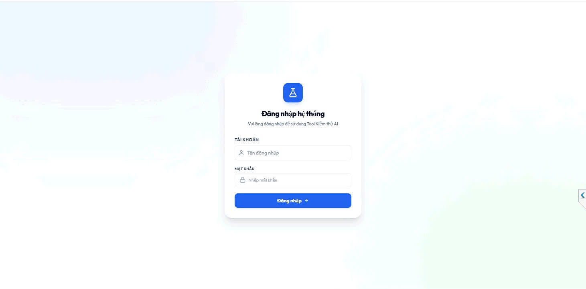
*Hình 1.1: Giao diện Đăng nhập hệ thống AutoTC (login.html) kết nối xác thực Supabase*

---

### 2. Chức năng Quản lý Bài toán Kiểm thử: Thao tác Thêm, Sửa, Xóa
* **Mục đích:** Giúp Tester và Admin khởi tạo, quản lý tập trung toàn bộ danh sách bài toán kiểm thử, cập nhật tài liệu đặc tả và loại bỏ các bài toán đã hết hạn.

#### A. Giao diện Bảng điều khiển Tổng quan (Dashboard)
* Màn hình chính phân tách trực quan: Cột bên trái là Form khởi tạo bài toán; Khu vực chính giữa là Bảng danh sách bài toán kèm ô tìm kiếm thời gian thực.
* Bảng hiển thị đầy đủ các cột: Checkbox chọn bài toán, Tên bài toán, Người làm, Trạng thái (Đã xong, Đang chạy, Chưa làm...), Liên kết URL gốc, Link Testcase (Sheets), Link Phân tích (Docs) và Cột nút Thao tác.

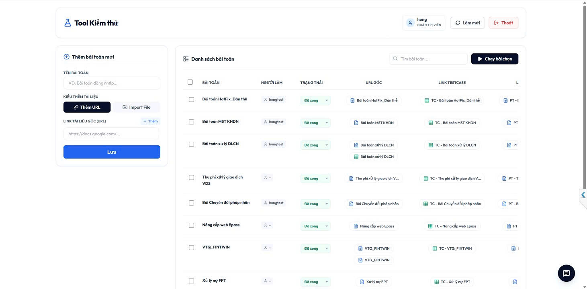
*Hình 2.1: Giao diện Bảng điều khiển (Dashboard) tổng quan và Danh sách bài toán kiểm thử*

#### B. Chức năng Thêm bài toán mới
Hỗ trợ 2 phương thức nhập liệu linh hoạt:
1. **Thêm URL trực tuyến:** Nhập tên bài toán (ví dụ: `Bài toán HotFix_Dán thẻ`), dán đường link Google Docs, Google Sheets hoặc Figma thiết kế. Có thể bấm `+ Thêm` để đính kèm nhiều URL trước khi lưu.
2. **Import File trực tiếp từ máy tính:** Chọn các tệp `.doc`, `.docx`, `.xls`, `.xlsx`, `.pdf`, `.txt`. Backend Python tự động upload lên Google Drive dự án và chuyển đổi định dạng tương thích cho AI phân tích.

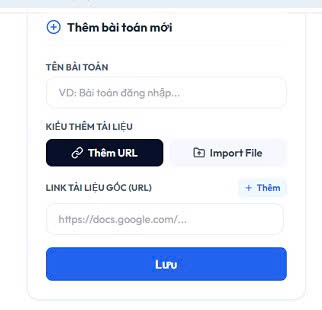
*Hình 2.2: Form Thêm bài toán mới hỗ trợ nhập URL đa liên kết và Import File tài liệu*

#### C. Chức năng Chỉnh sửa và Xóa bài toán
* **Chỉnh sửa bài toán (Update):** Bấm biểu tượng bút chỉnh sửa tại cột Thao tác, modal `Cập nhật bài toán` hiện lên cho phép cập nhật tên bài toán mới và danh sách liên kết tài liệu gốc. Dữ liệu được lưu ngay vào CSDL Supabase.
* **Xóa bài toán (Delete):** Bấm biểu tượng thùng rác để xóa bỏ bài toán không còn nhu cầu kiểm thử sau khi người dùng xác nhận an toàn trên popup cảnh báo.

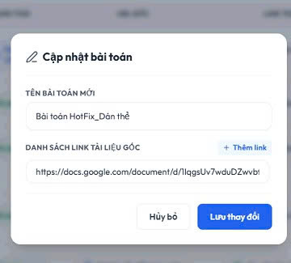
*Hình 2.3: Hộp thoại Modal 'Cập nhật bài toán' cho phép sửa tên và cập nhật link tài liệu*

---

### 3. Màn hình Cấu hình Prompt Thêm (AI Custom Prompt Modal)
* **Mục đích:** Cho phép Tester chủ động cung cấp các yêu cầu nghiệp vụ chuyên sâu hoặc định hướng kiểm thử bổ sung cho AI trước khi kích hoạt pipeline phân tích.
* **Khả năng tùy biến chuyên sâu:**
  * Khi Tester bấm nút chạy một bài toán cụ thể, hệ thống hiển thị modal `Chạy AI - [Tên bài toán]` (ví dụ: *Chạy AI - VTQ_FINTWIN*).
  * Khung văn bản **PROMPT AI** cho phép Tester đưa vào các chỉ thị kiểm thử nâng cao, ví dụ:
    * *Bổ sung kịch bản Negative case cho trường hợp nhập sai số điện thoại.*
    * *Tập trung kiểm thử Boundary case (giá trị biên) cho số tiền thanh toán từ 1.000 VNĐ đến 500.000.000 VNĐ.*
    * *Kiểm tra phân quyền: User thông thường không được phép gọi API phê duyệt.*
    * *Bổ sung kịch bản kiểm tra timeout hệ thống khi bên thứ ba phản hồi chậm.*
  * Người dùng nhấn nút **Bắt đầu chạy** (màu xanh dương) để tiến hành chạy, hoặc nhấn **Hủy bỏ** nếu muốn thoát.

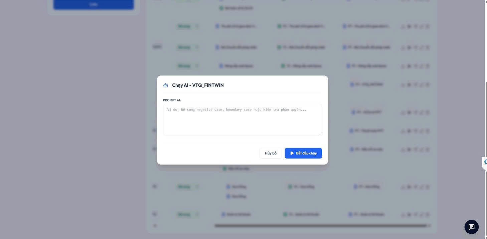
*Hình 3.1: Màn hình Modal Cấu hình Prompt AI bổ sung trước khi kích hoạt bài toán*

---

### 4. Màn hình Phân chia & Chuyển giao Bài toán (Task Assignment & Delegation)
* **Mục đích:** Minh bạch trách nhiệm kiểm thử, theo dõi tiến độ từng cá nhân và chuyển giao bài toán linh hoạt khi có sự điều động nhân sự.
* **Quy trình chuyển giao:**
  * Tại cột `NGƯỜI LÀM` trên Dashboard hiển thị tài khoản của người đang phụ trách bài toán (ví dụ: `hungtest`).
  * Khi nhấn vào tên người làm hoặc icon chuyển giao, modal **Chuyển giao bài toán** sẽ hiển thị: *"Bạn đang chuyển giao bài toán: [Tên bài toán]"*.
  * Dropdown **CHỌN NGƯỜI NHẬN** hiển thị danh sách toàn bộ các thành viên kiểm thử trong hệ thống (*hungtest, namnv, doanhdv, linhvt, anhhk, nhanvtth, detx, ducnm...*).
  * Sau khi chọn thành viên mới, thông tin người phụ trách được lưu ngay vào Supabase và đồng bộ Realtime lập tức hiển thị trên giao diện của cả hai phía.

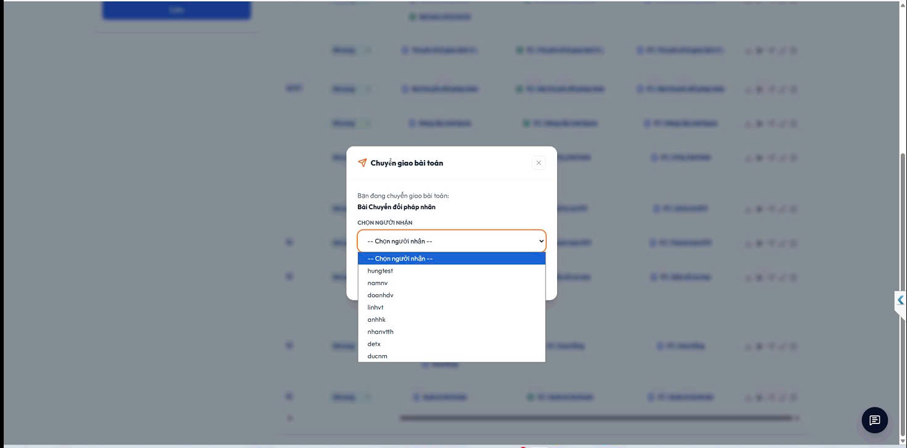
*Hình 4.1: Hộp thoại Modal 'Chuyển giao bài toán' với danh sách thành viên tiếp nhận*

---

### 5. Màn hình Bài toán Chạy & Theo dõi Tiến trình Thực thi (Real-time Execution & Tracking)
* **Mục đích:** Cung cấp góc nhìn trực quan theo thời gian thực về tiến độ phân tích tài liệu và sinh testcase của mô hình AI.
* **Đặc điểm nổi bật:**
  * Tester có thể tích chọn nhiều bài toán và bấm nút **Chạy bài chọn** (màu đen) để kích hoạt thực thi đa luồng song song thông qua `ThreadPoolExecutor` của Backend Python.
  * Cột TRẠNG THÁI tự động hiển thị nhãn `Đang chạy` màu xanh lơ nhạt kèm hiệu ứng loading spinner động.
  * Bộ đếm giờ thực thi (**Execution Tracker**) hiển thị chính xác thời gian đã chạy theo định dạng `mm:ss` (ví dụ: `00:09`), giúp Tester nắm rõ thời gian xử lý thực tế của AI.

---

### 6. Chức năng Dừng Bài toán Khẩn cấp (Stop Stream / Task Cancellation)
* **Mục đích:** Cho phép người dùng ngắt luồng xử lý bài toán ngay lập tức khi phát hiện nhập sai tài liệu, muốn đổi prompt hoặc tránh tiêu tốn tài nguyên tính toán không cần thiết.
* **Cơ chế kỹ thuật:**
  * Ngay khi có bài toán chuyển sang trạng thái Đang chạy, giao diện Dashboard lập tức hiển thị nút bấm màu đỏ: **Dừng bài đang chạy** (Stop button) bên cạnh nút Chạy bài chọn.
  * Khi nhấn nút, Frontend gửi yêu cầu POST đến endpoint `/api/tasks/stop` kèm ID bài toán. Tại Backend Python, `AiPipelineService` kích hoạt cờ `_cancelled_tasks`, ngắt kết nối với Viettel AI MaaS và giải phóng worker thread ngay lập tức.
  * Trạng thái bài toán được giải phóng và bộ đếm giờ dừng lại tức thời.

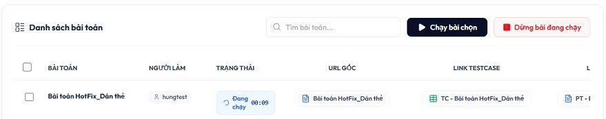
*Hình 5.1 & 6.1: Màn hình Bài toán đang chạy kèm đồng hồ đếm giờ (00:09) và Nút đỏ 'Dừng bài đang chạy'*

---

### 7. Chức năng Chọn Testcase & Duyệt Xem trước (Testcase Preview & Selection)
* **Mục đích:** Cho phép Tester xem trước danh sách kịch bản do AI vừa sinh ra, đánh giá chất lượng và chủ động chọn lọc các testcase phù hợp trước khi xuất ra file chính thức.
* **Các tính năng duyệt và chọn lọc:**
  * Hỗ trợ 2 chế độ hiển thị: Modal xem nhanh trên Dashboard hoặc nút `Toàn màn hình` để mở trang `review.html` chuyên dụng.
  * Bảng thống kê tức thời: Tổng số testcase sinh ra (ví dụ: `286`), Số lượng Đã giữ (`174`), Số lượng Bỏ qua (`112`).
  * Checkbox trước mỗi testcase cho phép chọn/bỏ chọn từng kịch bản, hoặc nhấn nút **Tích chọn tất cả để giữ** để chọn toàn bộ chỉ với một thao tác.
  * Thanh trạng thái hiển thị rõ: *"Đã tích chọn giữ 174/286 testcase. Bấm nút Xác nhận để lưu vào Sheet."*
  * Mỗi testcase hiển thị mã `[TC]_XXX`, tiêu đề tóm tắt và nút bấm màu xanh `✓ Giữ testcase` / `✕ Bỏ qua`.
  * Hỗ trợ ô tìm kiếm testcase theo từ khóa và bộ lọc sắp xếp thứ tự Tăng dần / Giảm dần theo ID.

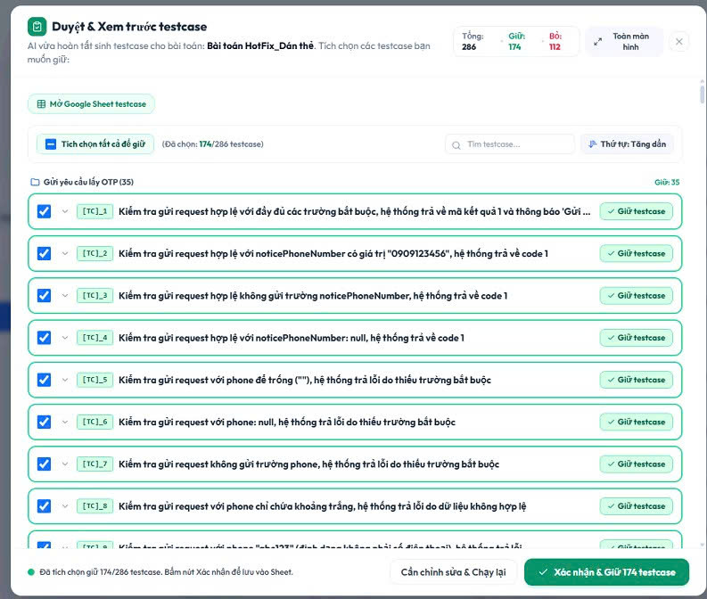
*Hình 7.1: Modal Duyệt & Xem trước testcase với cơ chế tích chọn, thống kê số lượng và lọc kịch bản*

---

### 8. Chức năng Chỉnh sửa Testcase Trực tiếp (Direct Testcase Editing)
* **Mục đích:** Cho phép Tester can thiệp trực tiếp vào từng kịch bản kiểm thử, chỉnh sửa chi tiết nội dung để đảm bảo tính chính xác 100% trước khi lưu trữ.
* **Các trường thông tin cho phép chỉnh sửa:**
  * **Mã & Tiêu đề testcase:** Sửa đổi mã định danh và nội dung tóm tắt hành vi kiểm thử.
  * **Tiền điều kiện (Pre-conditions):** Bổ sung dữ liệu người dùng cần có, trạng thái tài khoản, số dư, cấu hình hệ thống trước khi thực hiện test.
  * **Các bước thực hiện (Test Steps):** Chỉnh sửa tuần tự từng thao tác (gửi request POST với endpoint, body payload, header...).
  * **Kết quả mong đợi (Expected Results):** Bổ sung mã code trả về (`code = 1`, `mess = 'Gửi OTP thành công'`), các trường dữ liệu bắt buộc trong response payload.
  * **Độ ưu tiên & Phân loại:** Điều chỉnh Priority (*High, Medium, Low*) và Phân loại (*API, UI/UX, Security, Boundary*).
  * Toàn bộ chỉnh sửa được cập nhật vào trạng thái giao diện và sẵn sàng đồng bộ vào CSDL khi xác nhận.

---

### 9. Chức năng Chạy lại Testcase bằng AI (AI Revision & Re-run with Feedback)
* **Mục đích:** Khi kịch bản AI tạo ra lần đầu chưa đủ bao quát hoặc cần bổ sung các trường hợp biên/ngoại lệ, Tester có thể gửi phản hồi để AI tái sinh hoặc tạo thêm kịch bản dựa trên yêu cầu cụ thể mà không cần chạy lại toàn bộ tài liệu từ đầu.
* **Cơ chế phản hồi và tinh chỉnh:**
  * Tại chân modal duyệt, Tester bấm **Cần chỉnh sửa & Chạy lại**. Hệ thống mở rộng phân vùng `Gợi ý cải thiện testcase` và khung nhập chỉ thị.
  * **Bộ thẻ gợi ý nhanh (Quick Action Tags):** Tester chỉ cần bấm vào thẻ để hệ thống tự động điền yêu cầu vào khung:
    * `+ Negative case`: Bổ sung kiểm thử dữ liệu sai, giá trị âm.
    * `+ Boundary`: Bổ sung kiểm tra giá trị biên (độ dài tối đa, rỗng, null).
    * `+ Phân quyền`: Bổ sung kịch bản kiểm tra quyền hạn các vai trò khác nhau.
    * `+ Lỗi hệ thống`: Bổ sung kịch bản timeout, sập mạng, lỗi dịch vụ bên thứ ba.
    * `+ Expected Result`: Chuẩn hóa kết quả mong đợi chi tiết từng trường dữ liệu.
    * `+ Loại bỏ trùng lặp`: Rà soát loại bỏ các kịch bản tương đồng ngữ nghĩa.
    * `+ Viết lại toàn bộ`: Yêu cầu AI xóa bộ hiện tại và tạo mới hoàn toàn.
  * **Khung nhập 'NỘI DUNG YÊU CẦU AI ĐIỀU CHỈNH':** Cho phép gõ thêm các yêu cầu nghiệp vụ chuyên sâu (ví dụ: *Validate thông báo lỗi khi trùng fullName trên màn hình, kiểm tra không gọi API khi phone chứa ký tự đặc biệt...*).
  * Bấm nút **Chạy lại AI** (màu xanh dương) để kích hoạt pipeline AI cập nhật và bổ sung các kịch bản kiểm thử mới.

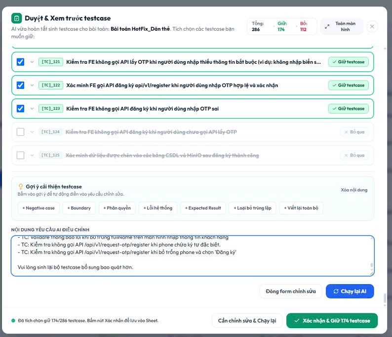
*Hình 9.1: Khung Gợi ý cải thiện testcase với các Tag nghiệp vụ, ô nhập chỉ thị và nút 'Chạy lại AI'*

---

### 10. Màn hình Kết quả Sau khi Hoàn thành: File Testcase & File Tài liệu Phân tích
* **Mục đích:** Tự động hoàn thiện và xuất bản các sản phẩm bàn giao (Deliverables) chuẩn hóa lên hệ sinh thái Google Workspace để Tester, Dev và PM sử dụng trực tiếp.

#### A. File Testcase Kết quả trên Google Sheets
Khi Tester nhấn **Xác nhận & Giữ [Số lượng] testcase**, hệ thống gọi Google Sheets API để ghi nhận toàn bộ kịch bản vào trang tính riêng mang tên bài toán (ví dụ: `[TC] Bài toán HotFix_Dán thẻ`):
* **Bảng thống kê Manual Test (Summary Box):** Tổng hợp tức thời Số trường hợp kiểm thử đạt (P), Không đạt (F), Đang xem xét (PE), Chưa thực hiện và Tổng số trường hợp kiểm thử (ví dụ: `174`).
* **Bảng kịch bản kiểm thử chức năng chi tiết:** Cung cấp đầy đủ các cột:
  * `ID`: Mã testcase chuẩn hóa (`[Tên_TC]_1`, `[Tên_TC]_2`...).
  * `Mục đích kiểm thử`: Mô tả chính xác mục tiêu ca kiểm thử.
  * `Các bước thực hiện`: Trình bày chi tiết từng bước thao tác (gửi request, tab Network F12...).
  * `Kết quả mong muốn`: Kết quả phản hồi dự kiến (Response payload, checksum...).
  * `Kết quả thực tế (UAT/Prod)`: Cột để Tester tích chọn Pass/Fail khi chạy thực tế.
  * `Data test các đợt`: Theo dõi dữ liệu kiểm thử qua từng vòng chạy (Lần 1, Lần 2, Lần 3...).
* **Định dạng trực quan:** Phân cách màu sắc tiêu chuẩn QA (tiêu đề vàng nhạt, tiêu mục xanh dương nhạt), kẻ viền ô bảng biểu rõ ràng.

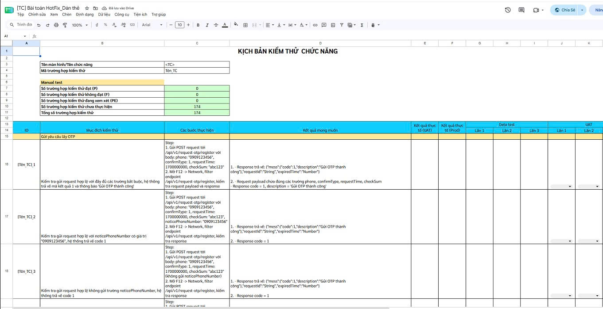
*Hình 10.1: File Google Sheets Kịch bản kiểm thử chức năng tự động xuất bản với đầy đủ tiêu chí chuẩn QA*

#### B. File Tài liệu Phân tích Nghiệp vụ trên Google Docs
Bên cạnh bảng testcase, hệ thống tự động sinh file Google Docs tài liệu phân tích nghiệp vụ (ví dụ: `Tài liệu phân tích Bài toán HotFix_Dán thẻ`) do module `BA Analysis Engine` biên soạn:
* **Mục 1 - Mục tiêu tài liệu:** Nêu rõ mục tiêu thiết kế tính năng, đối tượng người dùng thụ hưởng (ví dụ: khách hàng chưa có tài khoản thu phí tự động), phạm vi nghiệp vụ từ màn hình, thông tin khách hàng, hợp đồng, phương tiện đến OTP.
* **Mục 2 - Các hệ thống và API:** Đặc tả chi tiết các hệ thống liên quan (*Web Customer FE, BE CRM, MinIO Storage*) kèm danh sách API tham gia (endpoint POST `/api/v1/request-otp/register`, POST `/api/v1/register`, danh sách tham số, mã response, checksum, mã lỗi...).
* **Mục 3 - Luồng nghiệp vụ chính:** Trình bày mạch lạc luồng chuẩn (Happy Path) tuần tự từ Bước 1 đến Bước 12, kết hợp các luồng rẽ nhánh và ngoại lệ (Alternative & Exception Flows) khi nhập sai OTP, quá hạn OTP, dữ liệu trùng lặp...

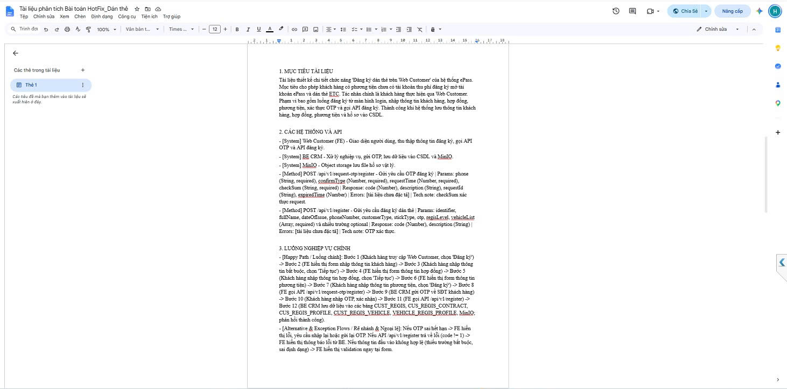
*Hình 10.2: File Google Docs Tài liệu phân tích nghiệp vụ tự động tổng hợp mục tiêu, API và luồng xử lý*

---

## PHẦN III: BẢNG TỔNG KẾT MA TRẬN HẠ TẦNG VÀ TÍNH NĂNG

| Phân hệ Kỹ thuật | Công nghệ / Nền tảng | Vai trò trong Hệ thống | Điểm Tích hợp / Giao diện |
| :--- | :--- | :--- | :--- |
| **Giao diện Người dùng** | HTML5, TailwindCSS, Lucide, JS ES6+ | Bảng điều khiển quản lý và điều phối toàn bộ hệ thống, gọi API non-blocking | `index.html`, `review.html`, `login.html` |
| **Máy chủ Dịch vụ** | Python 3.10+ (ThreadingHTTPServer) | Xử lý CRUD bài toán, điều phối AI pipeline, quản lý phiên và dừng luồng | RESTful API (`/api/tasks`, `/api/tasks/run`, `/api/tasks/stop`...) |
| **AI Pipeline Engine** | Native Python (`AiPipelineService`) | Trích xuất tài liệu, phân tích BA, trích xuất yêu cầu và sinh kịch bản testcase | `BE/services/ai_pipeline_service.py` |
| **Thu thập Tài liệu** | Python `DocumentCrawler` | Cào dữ liệu từ Google Docs, Google Sheets, Website và Figma REST API | `BE/services/doc_crawler.py` |
| **Bộ nhớ Tri thức & RAG** | `MemoryService` & ChromaDB | Lưu trữ vector embeddings, đối chiếu testcase lịch sử nhằm loại bỏ trùng lặp | `BE/chroma_db`, `memory_service.py` |
| **Mạng & Bảo mật** | Tailscale Mesh VPN + Funnel | Bảo vệ kết nối nội bộ giữa Backend và Dify, mở cổng HTTPS an toàn | Domain `vdtc-hungdv.tailfb2503.ts.net` (Port 8888) |
| **Cơ sở Dữ liệu Đám mây** | Supabase Cloud (PostgreSQL) | Lưu trữ người dùng, phân quyền, trạng thái bài toán và kết quả testcase JSON Realtime | Supabase Tables: `public.problems`, `public.users` |
| **Lưu trữ & Xuất bản** | Google Workspace (Drive, Docs, Sheets API) | Lưu trữ file gốc, tự động tạo Google Sheet testcase và Google Doc phân tích | Google API Client (OAuth 2.0 / Service Account) |
| **Trí tuệ Nhân tạo** | Viettel AI MaaS (`DeepSeek-V4.1-Flash`) | Mô hình ngôn ngữ lớn xử lý suy luận nhanh, sinh testcase bám sát nghiệp vụ | Viettel AI MaaS REST API |
| **Trợ lý Chatbot QA** | Dify AI Agent Platform | Cung cấp trợ lý ảo hỗ trợ giải đáp thắc mắc nghiệp vụ trực tiếp cho Tester | Side-panel iframe nhúng trên Dashboard |
| **Thiết kế Giao diện** | Figma REST API | Trích xuất wireframe, layout và thuộc tính UI/UX phục vụ sinh testcase màn hình | Figma Personal Access Token |
| **Điều khiển Thực thi** | `ThreadPoolExecutor` & Cancel Controller | Quản lý chạy song song nhiều bài toán và ngắt luồng khẩn cấp khi người dùng yêu cầu | `AiPipelineService._cancelled_tasks` |

---
*Tài liệu đặc tả yêu cầu chức năng và kiến trúc hạ tầng hệ thống AutoTC.*
